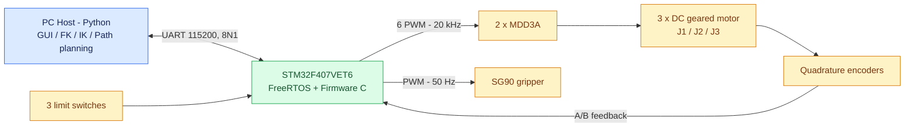
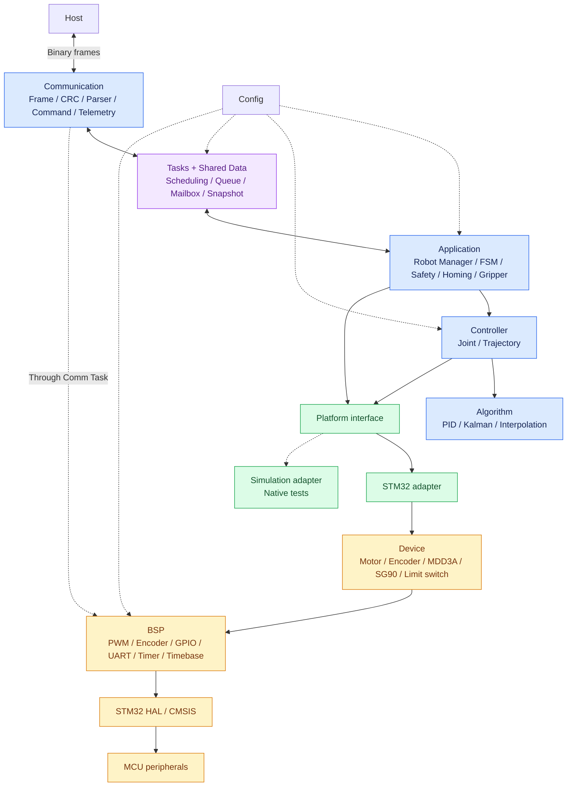
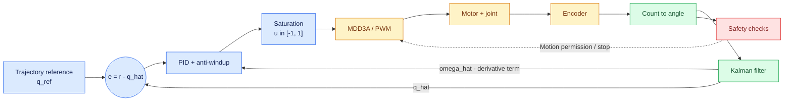
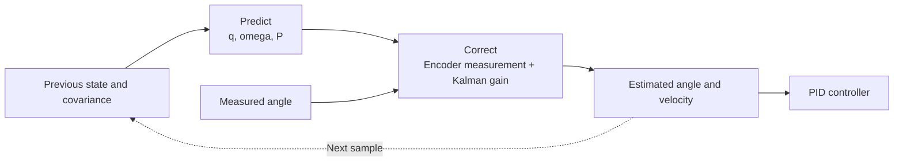
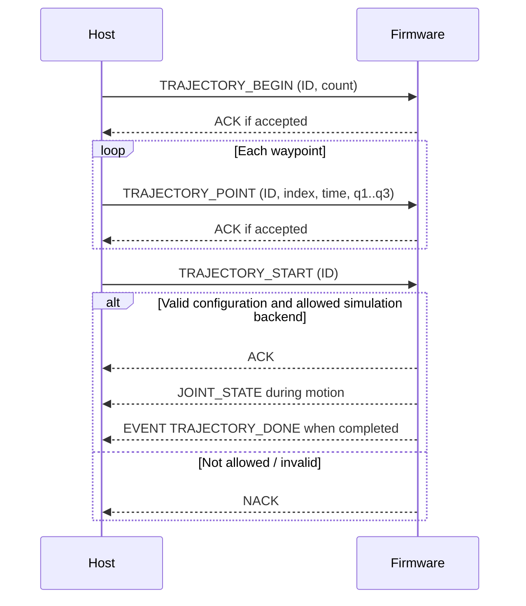
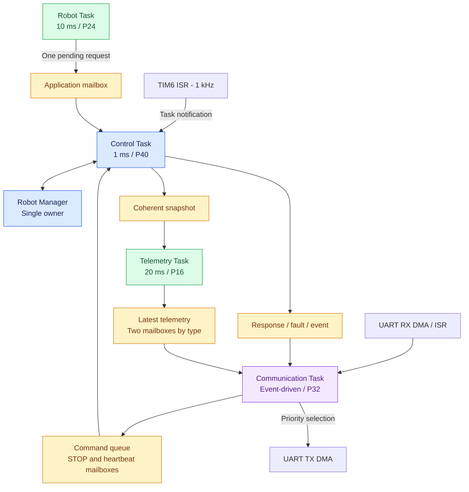
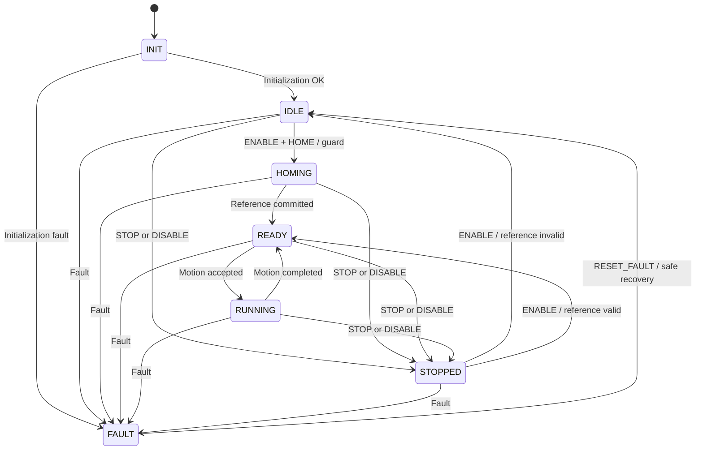
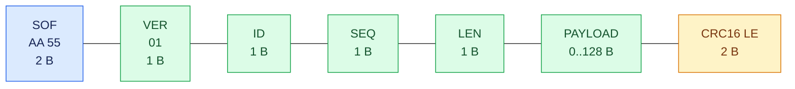
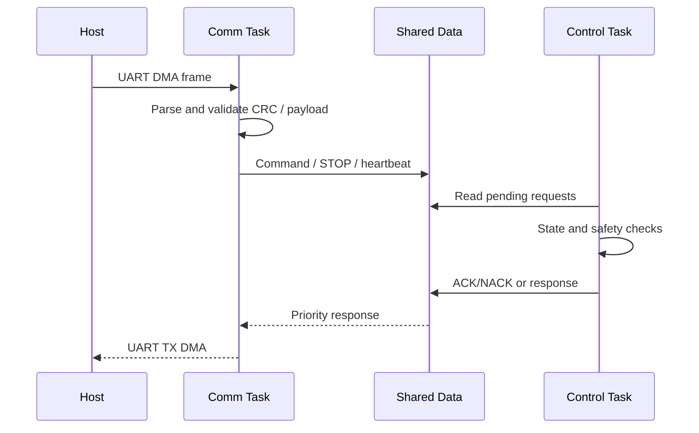

# Robot RRR 3-DOF — Embedded Firmware V1.0


Firmware điều khiển robot tay máy nối tiếp RRR ba bậc tự do (3-DOF), phát triển cho bài tập lớn môn Kỹ thuật Robot. Hệ thống sử dụng STM32F407VET6, FreeRTOS, PID vị trí, bộ lọc Kalman và giao thức UART nhị phân để kết nối với máy tính.

**Mục tiêu:** xây dựng firmware phân tầng, dễ kiểm thử và bảo trì; điều khiển ba khớp trong vòng lặp 1 kHz, tiếp nhận quỹ đạo từ Host, quản lý homing, gripper, trạng thái và các điều kiện an toàn.

> [!IMPORTANT]
> Phiên bản hiện tại đã được triển khai đến tầng FreeRTOS Tasks, có báo cáo native regression và Keil build thành công. Chưa xác nhận vận hành trên robot thật. STM32 service adapter, thông số hiệu chuẩn, chính sách dừng/giữ tải và kiểm chứng timing vẫn cần hoàn thiện. Không nạp/chạy actuator chỉ dựa trên kết quả build.

## 1. Tổng quan hệ thống



Sơ đồ thể hiện kiến trúc hệ thống mục tiêu, không phải sơ đồ đấu dây đã kiểm chứng.

| Thành phần | Vai trò |
|---|---|
| PC Host (Python, phía tích hợp) | Giao diện, động học thuận/nghịch, lập kế hoạch đường đi và quỹ đạo, giao tiếp và logging |
| STM32F407VET6 | Xử lý feedback, điều khiển vị trí, nội suy quỹ đạo, homing, safety và UART |
| 3 động cơ JGB37-520, 12 V, 60 rpm | Chấp hành cho J1 (base), J2 (shoulder), J3 (elbow), theo phần cứng dự kiến |
| 2 driver Cytron MDD3A | Điều khiển DC motor bằng dual-PWM; sử dụng 3 kênh |
| Quadrature encoder và limit switch | Phản hồi góc/vận tốc, xác lập tham chiếu và kiểm tra giới hạn |
| SG90 | Điều khiển đóng/mở gripper; chưa có feedback vị trí cơ khí độc lập |

Firmware V1.0 sử dụng một MCU và UART DMA; không phụ thuộc CAN, ROS 2 hoặc micro-ROS. Host hoàn chỉnh không nằm trong phạm vi source firmware hiện tại.

## 2. Kiến trúc phần mềm



Sơ đồ mô tả trách nhiệm và luồng tương tác, không phải toàn bộ quan hệ `#include`. FreeRTOS lập lịch các task; không phải một tầng mà mọi dữ liệu bắt buộc đi qua. Các thuật toán điều khiển không gọi HAL trực tiếp. Platform cung cấp interface để tái sử dụng phần lõi C trong native tests. Adapter dịch vụ cho Robot Manager trên STM32 còn thiếu, nên luồng điều khiển actuator thật chưa được kích hoạt.

| Tầng | Trách nhiệm |
|---|---|
| [Config](Firmware/Config/) | Pin mapping, timing, protocol và tham số hiệu chuẩn |
| [BSP](Firmware/BSP/) | Truy cập ngoại vi HAL, tính PWM, encoder wraparound, UART DMA, timer và timebase |
| [Device](Firmware/Device/) | Driver thiết bị và chuyển đổi dữ liệu vật lý |
| [Platform](Firmware/Platform/) | Interface chung cho STM32 và native test |
| [Algorithm](Firmware/Algorithm/) | PID, Kalman filter, nội suy tuyến tính |
| [Controller](Firmware/Controller/) | Điều khiển từng khớp và quản lý quỹ đạo nhiều waypoint |
| [Application](Firmware/Application/) | Robot Manager, FSM, homing, gripper, safety |
| [Communication](Firmware/Communication/) | Mã hóa/giải mã giao thức, CRC, parser và telemetry |
| [Tasks](Firmware/Tasks/) | Điều phối FreeRTOS, quyền sở hữu tài nguyên và đồng bộ |
| [Tests](Firmware/Tests/) | Unit tests và integration tests trên PC |

## 3. Điều khiển vị trí và ước lượng trạng thái



### 3.1. PID rời rạc

Mỗi khớp có một instance PID riêng. Chu kỳ điều khiển thiết kế là $T_s=1\,\mathrm{ms}$. Firmware sử dụng derivative on measurement để tránh derivative kick khi điểm đặt thay đổi:

$$e_k=q_{ref,k}-\hat q_k$$

$$I_k=I_{k-1}+K_iT_s e_k$$

$$u_k=\operatorname{sat}(K_pe_k+I_k-K_d\hat\omega_k)$$

Tích phân được giới hạn và chỉ cập nhật khi không làm bão hòa theo chiều bất lợi (conditional integration anti-windup). Output chuẩn hóa theo khoảng $[-1,1]$; dấu xác định chiều điều khiển và độ lớn biểu diễn duty yêu cầu. Duty thực tế có thể khác requested output khi driver bận hoặc safety can thiệp. Giá trị gain và dấu motor thật chưa được xác nhận.

Source: [`pid.c`](Firmware/Algorithm/pid.c), [`joint_controller.c`](Firmware/Controller/joint_controller.c), [`mdd3a.c`](Firmware/Device/mdd3a.c).

### 3.2. Kalman filter

Bộ lọc tuyến tính sử dụng mô hình vận tốc không đổi, chỉ lấy góc encoder làm phép đo; không sử dụng vận tốc sai phân cùng encoder như một phép đo độc lập.

$$x_k=\begin{bmatrix}q_k\\\omega_k\end{bmatrix},\quad A=\begin{bmatrix}1&T_s\\0&1\end{bmatrix},\quad H=\begin{bmatrix}1&0\end{bmatrix}$$

$$Q=S_a\begin{bmatrix}T_s^3/3&T_s^2/2\\T_s^2/2&T_s\end{bmatrix}$$



Covariance được cập nhật theo Joseph form; thuật toán kiểm tra dữ liệu hữu hạn và tính hợp lệ của covariance. Tham số nhiễu quá trình/đo phải được xác định khi tuning.

Source: [`kalman.c`](Firmware/Algorithm/kalman.c), [`encoder.c`](Firmware/Device/encoder.c).

### 3.3. Buffered trajectory

Host gửi toàn bộ quỹ đạo (tối đa 128 waypoint) trước khi yêu cầu START. Mỗi waypoint chứa thời gian tương đối và góc ba khớp; firmware kiểm tra ID, index, timestamp, giá trị hữu hạn, giới hạn và điều kiện khởi chạy, sau đó nội suy tuyến tính tại mỗi control step:

$$q_{ref}(t)=q_i+\frac{t-t_i}{t_{i+1}-t_i}(q_{i+1}-q_i)$$



**Giới hạn hiện tại:** `TRAJECTORY_START` chỉ hỗ trợ simulation backend; `SET_JOINT` chưa triển khai điều khiển vị trí trực tiếp. Nội suy tuyến tính có thể gây gián đoạn vận tốc tại waypoint; chưa chứng minh gia tốc liên tục. Host phải kiểm tra collision toàn đường đi, không chỉ các waypoint hoặc giới hạn từng khớp.

Source: [`trajectory_controller.c`](Firmware/Controller/trajectory_controller.c), [`interpolation.c`](Firmware/Algorithm/interpolation.c).

## 4. FreeRTOS và luồng dữ liệu

| Task | Priority CMSIS | Chu kỳ | Trách nhiệm |
|---|---:|---:|---|
| Control | High (40) | 1 ms, TIM6 notification | Single-owner Robot Manager, safety, PID, actuator và snapshot |
| Communication | AboveNormal (32) | Theo sự kiện | RX parser, dispatch, response, single-owner UART TX DMA |
| Robot | Normal (24) | 10 ms | Gửi application step request; không ghi actuator |
| Telemetry | BelowNormal (16) | 20 ms | Đọc snapshot nhất quán, đóng gói telemetry |



- Control Task xử lý STOP, heartbeat và tối đa hai command thường mỗi lượt, sau đó chạy control/safety; tối đa một application request được xử lý sau control step. `robot_application_step()` hiện chủ yếu cập nhật timestamp; homing và safety không bị chuyển sang chu kỳ 10 ms.
- Robot/Telemetry Task dùng lập lịch theo thời điểm tuyệt đối; không tích lũy nhiều step chạy bù khi trễ.
- Shared Data dùng vùng critical section giới hạn; snapshot nhất quán, không dùng `volatile` thay cơ chế đồng bộ.
- Communication Task ưu tiên ACK/NACK/FAULT/EVENT trước telemetry đang chờ; không ngắt frame DMA đang truyền. Telemetry mới có thể thay thế bản cũ cùng loại.
- DWT cycle counter cung cấp diagnostics execution cycles, wake latency, application cycles và deadline miss. Số đo nội bộ hiện chưa phải bằng chứng WCET toàn hệ thống hay hard real-time.

Source: [`control_task.c`](Firmware/Tasks/control_task.c), [`shared_data.c`](Firmware/Tasks/shared_data.c), [`communication_task.c`](Firmware/Tasks/communication_task.c), [`robot_task.c`](Firmware/Tasks/robot_task.c), [`telemetry_task.c`](Firmware/Tasks/telemetry_task.c).

## 5. Quản lý trạng thái và an toàn



Sơ đồ là các chuyển trạng thái chính; điều kiện đầy đủ nằm trong FSM và Robot Manager. STOPPED biểu thị dừng logic, không chứng minh cơ cấu đã dừng vật lý. Reset fault không tự enable actuator.

Homing dùng trình tự hai lần tiếp cận switch: kiểm tra trạng thái ban đầu, giải phóng switch nếu cần, seek, backoff, tiếp cận chậm, ghi reference encoder và đồng bộ controller. Raw switch được kiểm tra trong control path; debounce dùng để xác nhận trạng thái. Thứ tự, chiều và home offset thực tế chưa được kiểm chứng.

Safety theo dõi communication timeout, giới hạn vị trí, limit switch, encoder feedback, tracking error, homing timeout, driver fault (khi có dữ liệu hợp lệ), deadline miss, trajectory fault và E-stop input (khi được tích hợp). Chưa có xác nhận E-stop phần cứng; STOP qua UART không thay thế E-stop.

**Startup guard hiện tại:** khi chưa bind Robot Manager/configuration hợp lệ, Control Task suspend, TIM6 control không được start, không tự enable actuator. Communication hỗ trợ PING/GET_INFO tĩnh; command cần Robot Manager trả NACK_BUSY; không phát feedback giả. STOP vẫn có đường yêu cầu riêng. Không vô hiệu guard chỉ để thử động cơ.

Source: [`robot.c`](Firmware/Application/robot.c), [`state_machine.c`](Firmware/Application/state_machine.c), [`safety.c`](Firmware/Application/safety.c), [`homing.c`](Firmware/Application/homing.c), [`gripper.c`](Firmware/Application/gripper.c).

## 6. UART Binary Protocol V1.0

USART1, 115200 bps, 8N1, full-duplex, RX circular DMA và TX DMA. Số nhiều byte theo little-endian; góc dùng float32 rad, vận tốc rad/s, thời gian uint32 ms.



CRC-16/CCITT-FALSE: polynomial `0x1021`, initial `0xFFFF`, no reflection, XOR-out `0x0000`. Vùng tính CRC từ VER đến hết PAYLOAD, không gồm SOF và CRC. Frame dài 8–136 byte. Vector ASCII `123456789` cho CRC `0x29B1`.

| Host → STM32 | ID | Payload (byte) |
|---|---:|---:|
| PING / GET_INFO / GET_STATE | 0x01 / 0x02 / 0x03 | 0 |
| ENABLE / DISABLE / HOME | 0x10 / 0x11 / 0x12 | 0 |
| SET_JOINT (chưa hỗ trợ) | 0x20 | 12 |
| TRAJECTORY_POINT | 0x21 | 20 |
| TRAJECTORY_BEGIN | 0x22 | 4 |
| TRAJECTORY_START | 0x23 | 2 |
| TRAJECTORY_CLEAR | 0x24 | 0 |
| GRIPPER | 0x30 | 1 |
| STOP / RESET_FAULT | 0x40 / 0x41 | 0 |
| HEARTBEAT | 0x50 | 0 |

| STM32 → Host | ID | Payload (byte) |
|---|---:|---:|
| ACK / NACK | 0x80 / 0x81 | 2 |
| PONG | 0x82 | 0 |
| ROBOT_INFO | 0x83 | 8 |
| STATE_REPLY / JOINT_STATE | 0x84 / 0x90 | 34 |
| CONTROL_DEBUG | 0x91 | 40 |
| FAULT | 0xA0 | 6 |
| EVENT | 0xA1 | 5 |



ACK xác nhận lệnh được chấp nhận, không đồng nghĩa chuyển động đã hoàn thành; EVENT thông báo hoàn thành. Response giữ SEQ request; telemetry/event dùng sequence riêng. Retry cùng SEQ và nội dung được xử lý bằng cache; HEARTBEAT không ACK. ACK status `0x00` và chính sách reconnect hiện hành vẫn cần thống nhất với Host.

| Timing thiết kế | Giá trị |
|---|---:|
| ACK timeout | 100 ms |
| Heartbeat interval | 100 ms |
| Communication timeout | 500 ms |
| JOINT_STATE | 20 ms / 50 Hz |
| CONTROL_DEBUG | 20 ms / 50 Hz khi bật (mặc định tắt) |
| Telemetry maximum age | 40 ms |

JOINT_STATE dùng q/dq từ feedback Robot Manager. CONTROL_DEBUG dùng sai số `q_ref - estimated_q` và requested output. Snapshot invalid, stale hoặc không hữu hạn không được phát như dữ liệu hợp lệ. Hai loại telemetry cùng bật dùng 4.500 byte/s (khoảng 39,1% băng thông TX lý thuyết 115200 8N1), chưa tính response/event và overhead thời gian thực.

Source: [`communication_config.h`](Firmware/Config/communication_config.h), [`protocol.h`](Firmware/Communication/protocol.h), [`command.c`](Firmware/Communication/command.c), [`telemetry.c`](Firmware/Communication/telemetry.c).

## 7. Cấu hình STM32

STM32F407VET6 Cortex-M4F, HSE 8 MHz, SYSCLK 168 MHz, Flash 512 KiB, SRAM danh định 192 KiB (128 KiB SRAM thường và 64 KiB CCM; DMA không truy cập CCM).

| Joint | PWM A/B | Encoder A/B | Limit switch |
|---|---|---|---|
| J1 | TIM1 CH1/2 — PE9/PE11 | TIM2 — PA5/PA1 | PE2 |
| J2 | TIM1 CH3/4 — PE13/PE14 | TIM3 — PC6/PC7 | PE3 |
| J3 | TIM12 CH1/2 — PB14/PB15 | TIM4 — PD12/PD13 | PE4 |

| Peripheral | Cấu hình |
|---|---|
| Motor PWM | 20 kHz; TIM1 PSC=0 ARR=8399; TIM12 PSC=0 ARR=4199 |
| Encoder | TIM2 32-bit; TIM3/TIM4 16-bit; quadrature |
| Gripper | TIM5 CH3 PA2; 50 Hz, PSC=83 ARR=19999 |
| Control timer | TIM6, 1 kHz, PSC=83 ARR=999; IRQ priority 5 |
| HAL timebase | TIM7 |
| RTOS tick | SysTick, 1 kHz |
| UART | USART1 PA9 TX, PA10 RX; DMA2 Stream2 RX / Stream7 TX, Channel 4 |
| Stack | 512 words (2.048 byte) mỗi task ứng dụng |
| FreeRTOS heap | 32.768 byte |

Pin mapping trên là cấu hình firmware, chưa phải wiring đã xác nhận. CPR, encoder sign, joint limits, PID gains, gripper pulses và stop policy vẫn chưa được đánh dấu verified. IWDG chưa bật.

Source: [`Firmware.ioc`](Firmware/Firmware.ioc), [`hardware_config.h`](Firmware/Config/hardware_config.h), [`robot_config.h`](Firmware/Config/robot_config.h), [`control_config.h`](Firmware/Config/control_config.h).

## 8. Cấu trúc repository

```text
Robot/
├── .vscode/                  # IntelliSense và build task
├── Firmware/
│   ├── Config/               # Hardware, robot, control, communication
│   ├── Core/                 # CubeMX-generated startup/application entry
│   ├── Drivers/              # CMSIS và STM32 HAL
│   ├── Middlewares/          # FreeRTOS
│   ├── BSP/                  # Peripheral abstraction
│   ├── Device/               # Device drivers
│   ├── Platform/
│   │   ├── STM32/            # Target adapter
│   │   └── Simulation/       # Native test adapter
│   ├── Algorithm/            # PID, Kalman, interpolation
│   ├── Controller/           # Joint, trajectory
│   ├── Application/          # Robot, FSM, safety, homing, gripper
│   ├── Communication/        # Protocol, CRC, frame, parser, telemetry
│   ├── Tasks/                # 4 FreeRTOS tasks và shared data
│   ├── Tests/
│   │   ├── Unit/             # Native test runner và unit tests
│   │   └── Integration/      # UART DMA mock, robot và task pipeline
│   ├── MDK-ARM/              # Keil project và assembly startup
│   └── Firmware.ioc          # STM32CubeMX project
└── README.md
```

## 9. Build và kiểm thử

Môi trường: STM32CubeMX (STM32Cube FW_F4 V1.28.3), Keil µVision 5.43.1, ARM Compiler 6.24, VS Code và MSVC Build Tools 2022 cho native tests.

Clone repository:

```bash
git clone https://github.com/trilehoangminh-source/Robot.git
cd Robot
```

**Build STM32:** mở [`Firmware/MDK-ARM/Firmware.uvprojx`](Firmware/MDK-ARM/Firmware.uvprojx) trong Keil, chọn target Firmware và ARM Compiler 6.24, thực hiện Build/Rebuild. Cần MDK license hợp lệ và device pack tương ứng. VS Code dùng để chỉnh source trên cùng thư mục; có thể cần sửa đường dẫn toolchain theo máy. Khi generate lại CubeMX, bảo toàn USER CODE, source groups, include paths và FreeRTOS GCC/ARM_CM4F port tương thích AC6; kiểm tra lại build.

**Native regression:** trên Windows, từ root repository chạy:

```powershell
.\Firmware\Tests\Unit\run_tests.cmd
```

Script dùng MSVC C11, `/W4 /WX`; kiểm tra đường dẫn `vcvars64.bat` nếu Build Tools được cài ở vị trí khác. Test runner hiện khai báo 17 executable test groups, bao phủ Algorithm, BSP math, Device, Platform, Controller, FSM, Safety, Homing, Gripper, Robot Manager, Communication, Shared Data, UART DMA mock và task pipeline.

### Kết quả build/test đã báo cáo (27/11/2026)

| Hạng mục | Kết quả |
|---|---|
| Native regression MSVC `/W4 /WX` | 17/17 nhóm PASS |
| Keil ARM Compiler 6.24 | 0 errors, 0 warnings; tạo HEX thành công |
| Code / RO / RW / ZI | 47.514 / 654 / 16 / 45.024 byte |
| Flash (Code + RO + RW) | 48.184 byte (~47,1 KiB; 9,2% của 512 KiB) |
| RAM (RW + ZI) | 45.040 byte (~44 KiB; 34,4% nếu so với 128 KiB SRAM thường) |

Số liệu lấy từ báo cáo build/test ở mốc 8.3 của dự án, không phải kết quả CI tự động hoặc lần chạy lại khi viết README. Heap/MSP đã bao gồm trong số RAM linker; không cộng lại stack task cấp từ heap. Kết quả native test không chứng minh timing, concurrency hay UART/PWM/encoder vật lý trên MCU. Chưa đo stack high-water mark thực tế.

## 10. Tiến độ và giới hạn hiện tại

| Hạng mục | Trạng thái |
|---|---|
| Config, BSP, Device, Platform | Đã triển khai nền tảng; còn adapter dịch vụ STM32 |
| PID, Kalman, Interpolation | Đã triển khai, native tests |
| Joint / Trajectory Controller | Đã triển khai; START chỉ simulation |
| UART Protocol / Communication | Đã triển khai, native tests và DMA mock |
| Robot Manager / FSM / Safety / Homing / Gripper | Đã triển khai logic; chưa kiểm chứng phần cứng |
| FreeRTOS bốn task | Đã triển khai, integration test |
| STM32 build | Thành công theo báo cáo |
| Calibration, tuning, hardware timing và Host integration | Chưa kiểm chứng |

Các công việc cần hoàn thành trước khi chạy robot thật: bind service adapter, xác nhận pinout và thông số encoder/motor/joint, xây dựng cơ chế dừng và giữ tải J2/J3 (PWM zero không mặc nhiên giữ được trọng lực), kiểm chứng đường homing/quỹ đạo không va chạm, E-stop và watchdog, đo jitter/deadline/stack, tuning từng khớp và kiểm thử giao tiếp Host. Giai đoạn MuJoCo SIL đang tạm hoãn; simulation adapter vẫn được giữ để phục vụ native tests.

## 11. Hướng đọc source code

Bắt đầu từ [`main.c`](Firmware/Core/Src/main.c) để hiểu startup và task entry, sau đó đọc lần lượt:

`Config → BSP → Device → Platform → Algorithm → Controller → Application → Communication → Tasks → Tests`

Đối chiếu mỗi module với header public, implementation và unit/integration test tương ứng để hiểu chức năng, luồng dữ liệu và các điều kiện lỗi.

---

**Robot RRR 3-DOF | Firmware V1.0** — Modular embedded control system for an academic robotics project.
